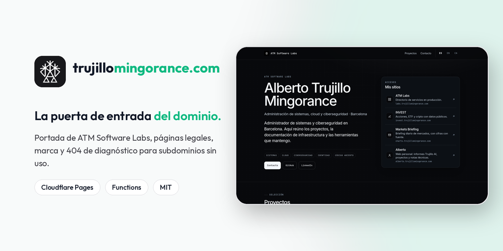
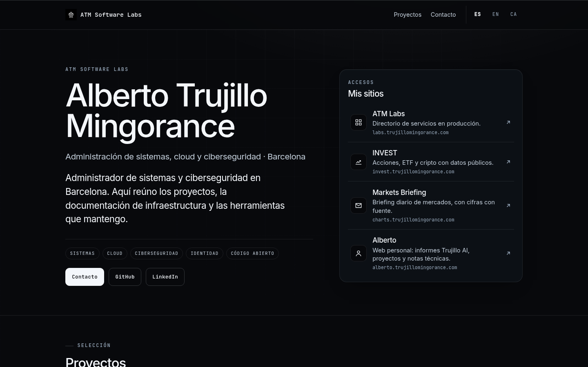
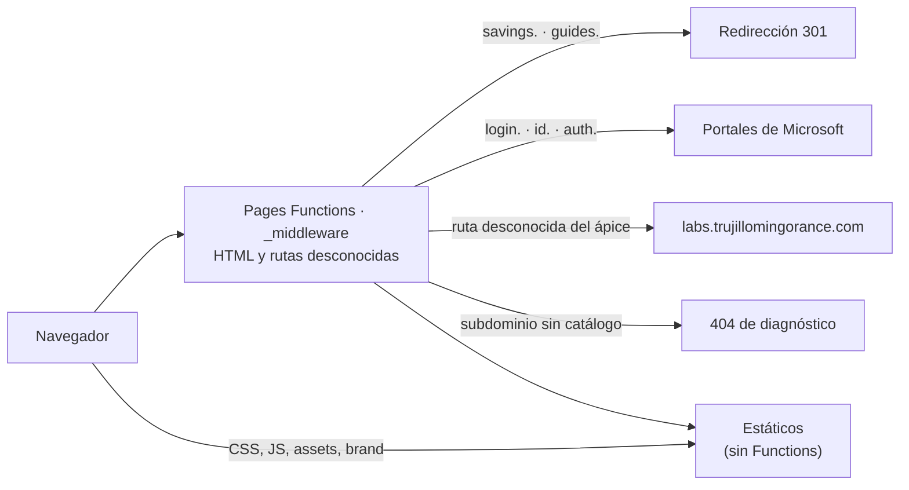

<p align="center">
  
</p>

<p align="center">
  <strong>Portada de ATM Software Labs en trujillomingorance.com: presentación, sitios, páginas legales, marca, firma de correo y 404 de diagnóstico para subdominios sin uso.</strong><br/>
  <em>Apex site for trujillomingorance.com: home, legal pages, brand kit, email signature and a diagnostic 404 for unmapped subdomains (ES · EN · CA).</em>
</p>

<p align="center">
  <a href="https://trujillomingorance.com"><b>trujillomingorance.com</b></a> ·
  <a href="https://trujillomingorance.com/brand/">Marca</a> ·
  <a href="https://trujillomingorance.com/firma/">Firma de correo</a> ·
  <a href="LICENSE">Licencia MIT</a>
</p>

<p align="center">
  
  
  
</p>

---

## Capturas

<p align="center"></p>

## Funciones

- **Portada** con presentación, lista de sitios y proyectos, en español (`/`), inglés (`/en/`) y catalán (`/ca/`).
- **Páginas:** sobre mí (`/sobre-mi`, `/en/about`), privacidad, términos, marca (`/brand/`) y generador de **firma de correo** (`/firma/`).
- **Marca común:** logotipos en SVG (símbolo, wordmark y lockups en claro y oscuro) y `brand/tokens.css`, que copian el resto de webs.
- **Redirecciones de host** en el borde:
  - `savings.` y `finance.` → `savings.trujillomingorance.com`; `guides.` → `guides.trujillomingorance.com`.
  - `login.` → portal My Apps de Microsoft del tenant; `id.`, `auth.` y `security.` → My Account.
  - Rutas desconocidas del ápice → `labs.trujillomingorance.com`.
- **404 de diagnóstico:** un subdominio que no está en el catálogo recibe una página con Ray ID, centro de datos, protocolo y enlaces a los servicios que sí existen.
- **Enlace «Panel interno»** para cuentas internas de Microsoft Entra ID.

## Stack

| Capa | Tecnología |
|---|---|
| Frontend | HTML generado con scripts de Node (`site/`), CSS y JavaScript sin framework |
| Hosting | **Cloudflare Pages** (`public/`) |
| Borde | **Pages Functions**: `_middleware.js` para redirecciones y 404 de diagnóstico |
| Marca | SVG generados con `brand/build_logo.py` |
| CI | GitHub Actions: pruebas en cada push y PR |

## Arquitectura



`_routes.json` saca de Functions los CSS, JS, `/assets/*`, `/brand/*` e iconos, así que solo el HTML y las rutas desconocidas pasan por el middleware.

La carpeta `ingress/` contiene una versión del 404 de diagnóstico como Worker independiente (`atm-edge-ingress`). Ahora mismo **no está desplegada**: lo resuelve el middleware de Pages.

## Seguridad

- **Cabeceras** en `_headers` y en el middleware: CSP (scripts propios y la analítica de Cloudflare; `connect-src` limitado a los sitios del dominio), HSTS con preload, `X-Frame-Options: DENY`, `nosniff`, Referrer-Policy y Permissions-Policy.
- `/favicon.ico` redirige a un archivo versionado porque la caché de la zona ignora la query en esa ruta.

## Desarrollo local

Requisitos: **Node.js ≥ 20**.

```bash
git clone https://github.com/ATM-Software-Labs/domain-root.git && cd domain-root
npm run build:site                 # regenera las páginas de public/
npm test                           # node --test
npx wrangler pages dev public      # http://localhost:8788
```

| Comando | Qué hace |
|---|---|
| `npm run build:site` | Genera portada y páginas en cada idioma |
| `npm test` | Pruebas de rutas, redirecciones y páginas |
| `npm run deploy` | `wrangler pages deploy public --project-name=domain-root` |

## Despliegue

El proyecto de Cloudflare Pages `domain-root` está conectado a GitHub: cada push a `main` publica en `trujillomingorance.com`. No necesita secretos.

| Nombre | Tipo | Uso |
|---|---|---|
| `CATALOG` | binding KV, opcional | Catálogo de subdominios para el 404 de diagnóstico |
| `EDGE_CATALOG_JSON` | variable, opcional | El mismo catálogo en JSON. Sin ninguno de los dos se usa el del código |

## Estructura

```
public/        páginas generadas, _headers, _redirects, _routes.json, css/, js/, assets/, brand/
functions/     _middleware.js, rutas-hub.js, lib/diagnostico.js
site/          generadores de la portada y las páginas legales
brand/         logotipos SVG y script de generación
ingress/       Worker de diagnóstico (no desplegado)
test/          pruebas con node --test
docs/          banner y capturas
```

## Licencia

[MIT](LICENSE) © 2026 Alberto Trujillo Mingorance.

<p align="center"><sub>© 2026 ATM Software Labs · <a href="https://trujillomingorance.com">trujillomingorance.com</a></sub></p>
